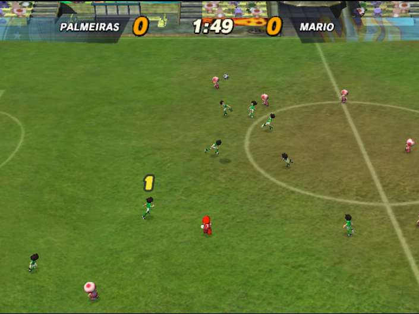
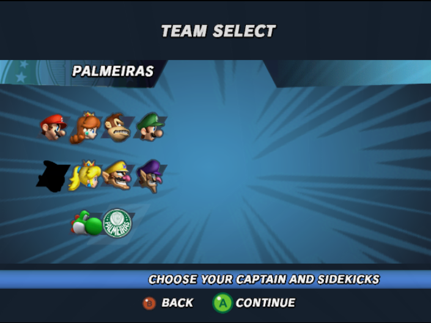
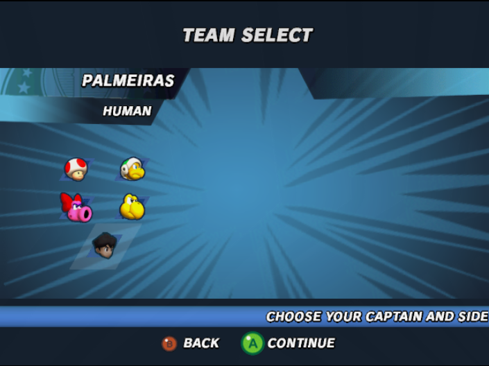
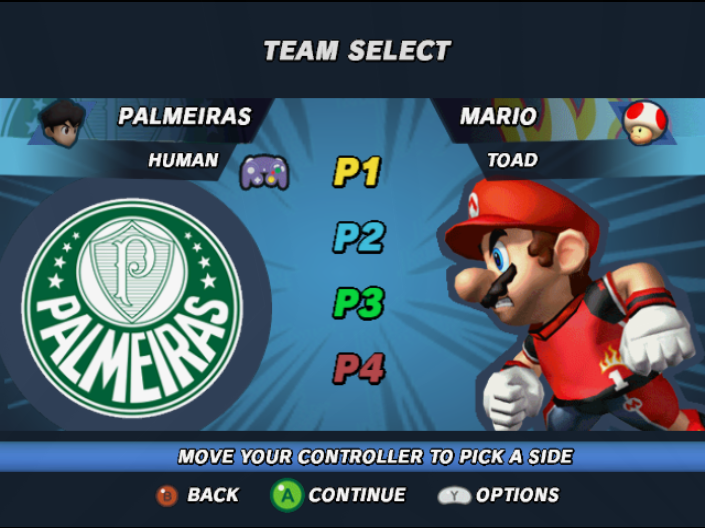

# Strikers decomp mods

**More players. A bigger pitch. Your own roster.**

A playable proof of concept for expanding **Super Mario Strikers**—and a starting point for your own mods.

[**Download v1.0.0**](https://github.com/piuzera/strikers-decomp-mods/releases/tag/v1.0.0) · [**Install**](docs/install.md) · [**Create a mod**](modding/README.md) · [**Watch the demo**](media/demo.webm)

*11-a-side, on a Palace twice the original length and width.*

## The proof of concept

| Feature | Try it |
| --- | --- |
| **11-a-side football** | One captain, nine sidekicks and a goalkeeper per team, with expanded formations and replay support. |
| **A larger Palace** | Choose **The Palace** for the enlarged pitch, matching goals and corrected stadium geometry. |
| **A new captain** | Choose **Palmeiras**: an independent tenth team, keeping the original captains available. |
| **A new sidekick** | Choose **Human**, the fifth sidekick option. Palmeiras + Human gives you ten human outfielders. |

## From selection to kickoff

<table>
  <tr>
    <td width="50%"> <strong>01 · Choose your captain</strong> Palmeiras joins the original roster.</td>
    <td width="50%"> <strong>02 · Pick your sidekick</strong> Human is selectable independently.</td>
  </tr>
  <tr>
    <td> <strong>03 · Ready up</strong> Custom crest, portraits and matchup presentation.</td>
    <td> <strong>04 · Watch it in motion</strong> <a href="media/demo.webm">86-second demo: title screen → selection → gameplay ↗</a></td>
  </tr>
</table>

### Full demo

<video src="https://raw.githubusercontent.com/piuzera/strikers-decomp-mods/main/media/demo.webm" controls preload="none" poster="https://raw.githubusercontent.com/piuzera/strikers-decomp-mods/main/media/gameplay.png" width="712"></video>

[Open the recording](media/demo.webm) if your GitHub client does not display a player.

## Play

**Dolphin · USA Rev 0 (`G4QE01`) · Python 3.10+ · 48 MiB MEM1**

Download the [release ZIP](https://github.com/piuzera/strikers-decomp-mods/releases/latest), extract your own clean game in Dolphin, then follow your platform guide:

**[Windows](docs/windows.md) · [Linux](docs/linux.md) · [macOS](docs/macos.md)**

The included installer applies patches; its launcher sets the required memory. Normal progression is retained. GameCube hardware is not supported; Nintendont is untested. [Installation & FAQ →](docs/install.md)

## Make something of your own

Start with the **[creator kit](modding/README.md)**: a pinned source patch, asset tools and editable templates for captains, sidekicks, UI artwork, models, formations and stadium geometry. No private Blender project is needed to start editing the example.

**[Set up a workspace](modding/guides/getting-started.md)** → **[Customize the roster](modding/guides/captain-and-sidekick.md)** → **[Package your mod](modding/guides/testing-and-packaging.md)**

## Completed, and yours to build on

This was a fun spare-time project, released **as-is with no updates or support planned**. The final game and Palace polish were confirmed working in Dolphin. Fork it, learn from it and take the idea further. [Release notes](RELEASE_NOTES.md) · [Credits](docs/credits.md)

Original release utilities/docs: [MIT](LICENSE). Creator-overlay contributions retain their existing licenses; game-derived source/patch content and trademarks are not relicensed under MIT. [Third-party notices](THIRD_PARTY_NOTICES.md).
